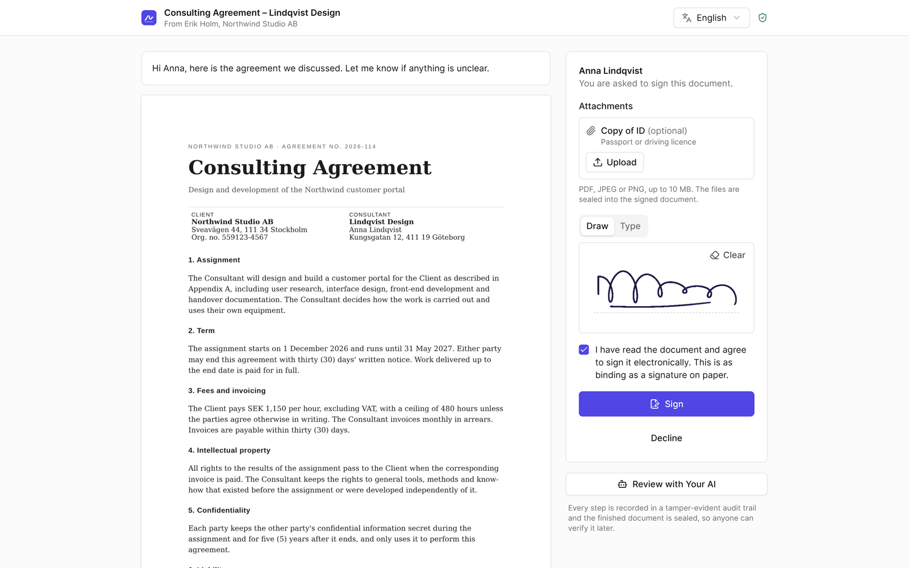
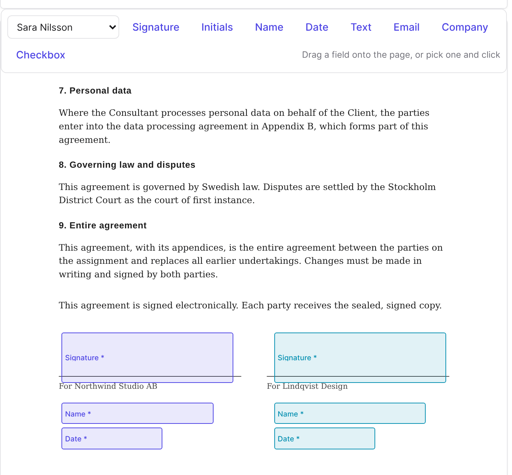
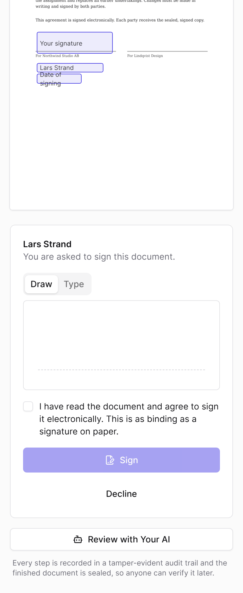
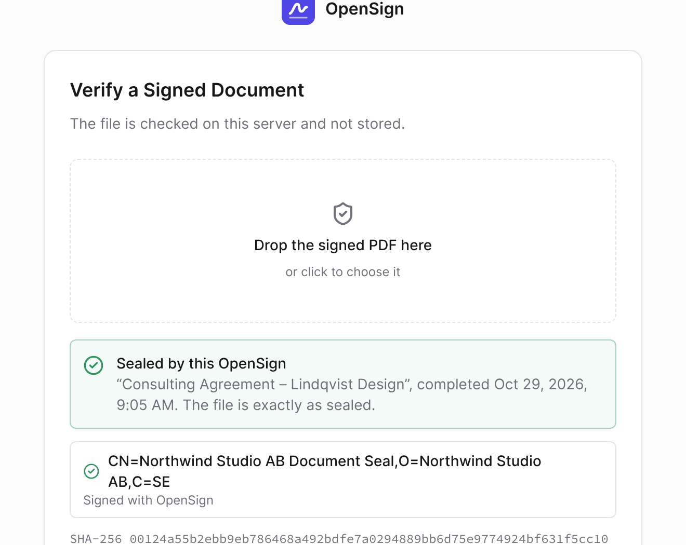
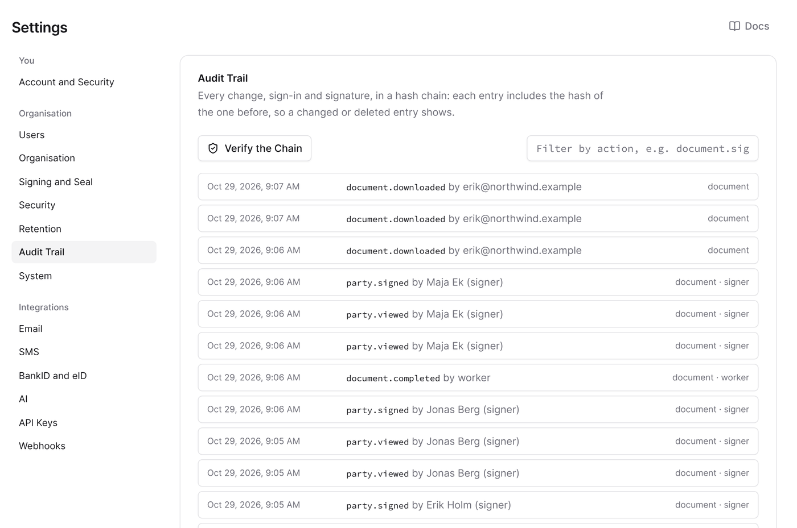
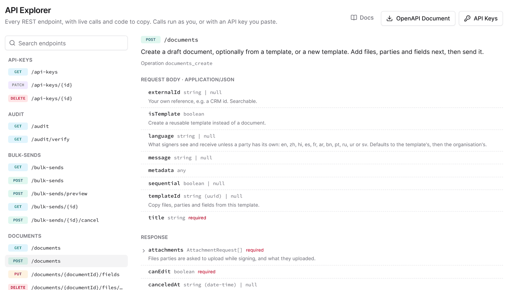
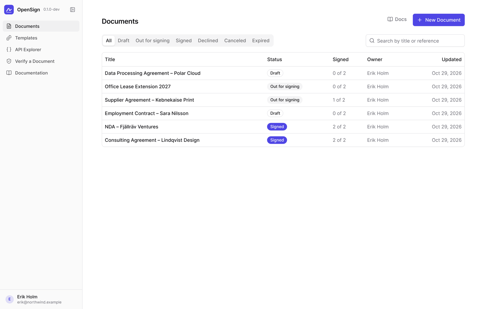
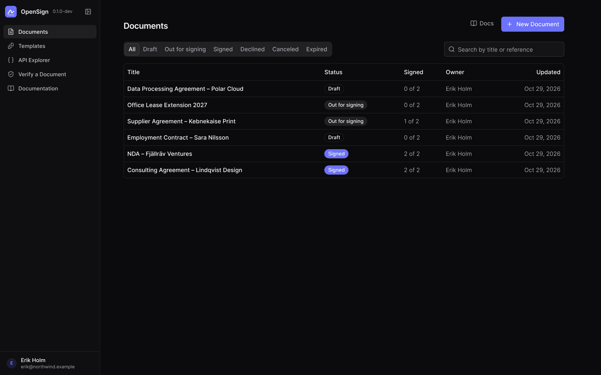
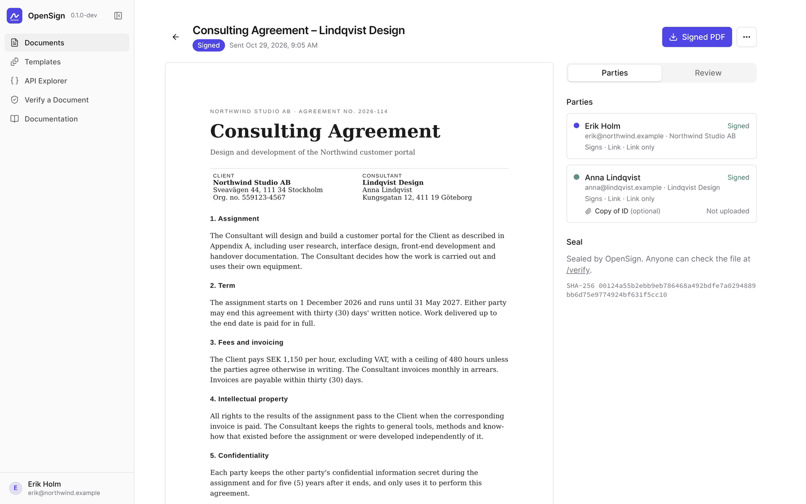
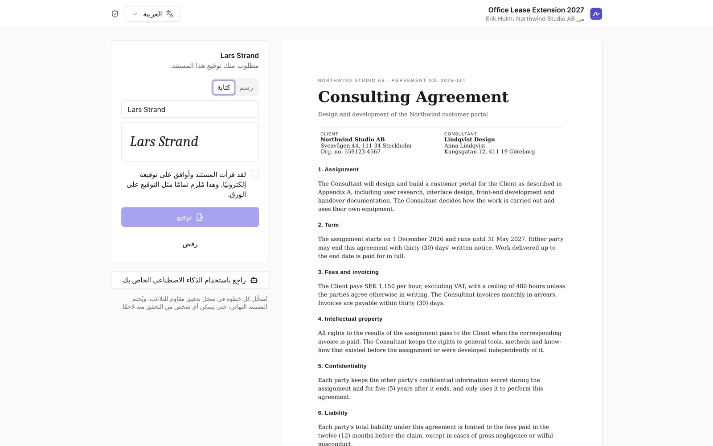

<div align="center">


# OpenSign

**Electronic signatures you run yourself.**<br>
Send a PDF or Word document, collect signatures with email, SMS or BankID, and get back a sealed PDF that any PDF reader can verify.

[](https://github.com/nielsbosma/OpenSign/actions/workflows/ci.yml)
[](LICENSE)
[](https://github.com/nielsbosma/OpenSign/pkgs/container/opensign)
[](crates)
[](docs/sealed-pdfs.md)

[Documentation](docs/index.md) · [Quick start](docs/quick-start.md) · [Deploy](#deploy-in-five-minutes) · [API](docs/api.md) · [Security](SECURITY.md)

<br>



</div>

## Why OpenSign

Hosted e-signature services charge per user or per envelope, keep your contracts on their servers, and lock your integrations to their API. OpenSign is one container you deploy next to your own database and bucket:

- **Your documents stay yours.** Files are encrypted before they reach your S3 bucket, and nothing leaves your install unless you turn it on.
- **Drop-in for Scrive and DocuSign.** Point an existing integration at OpenSign by swapping the base URL. No rewrite.
- **Evidence that holds up.** Every signed PDF carries a PAdES B-LTA seal, an RFC 3161 time stamp and evidence pages, and can be checked in any PDF reader without OpenSign.
- **Nordic identification built in.** Swedish BankID, Freja eID and other Nordic eIDs through an OpenID Connect broker, plus SMS codes.
- **Free and open.** MIT licensed. Pay only for the server it runs on.

|  | OpenSign | Hosted e-signature services |
| --- | --- | --- |
| Where documents live | Your Postgres and S3 bucket, encrypted | The vendor's cloud |
| Pricing | Free, MIT licensed | Per user or per envelope |
| Integrations | Own REST API, plus Scrive v2 and DocuSign v2.1 compatible endpoints | One vendor's API |
| Without internet | Runs fully on your own network | Needs the vendor's cloud |
| AI | Bring your own model, off by default, MCP server for Claude | Vendor's choice |
| Source code | Open, auditable, [threat model](SECURITY.md) included | Closed |

## Features

<table>
<tr>
<td width="50%" valign="top">

### Prepare and send
Upload PDF or Word files, drag fields onto the page and pick who fills what. Signers, approvers and viewers, in order or all at once. Delivery by email, SMS, a link you hand over, or in person on your own device. Reminders, expiry, templates and [bulk send](docs/bulk-send.md) from CSV or Excel. [Folders and an archive](docs/folders.md) keep long lists in order.

</td>
<td width="50%" valign="top">



</td>
</tr>
<tr>
<td width="50%" valign="top">



</td>
<td width="50%" valign="top">

### Sign anywhere, in any language
No account and no app needed. Draw or type a signature on desktop or phone, upload requested attachments such as an ID copy, or decline with a reason. Signers can [identify](docs/identification.md) with an email link, SMS code, BankID, Freja or a broker eID. With a personal number on the party, only that person can sign.

</td>
</tr>
<tr>
<td width="50%" valign="top">

### Sealed, verifiable PDFs
When everyone has signed, OpenSign stamps the signatures, adds evidence pages of who signed, when and how, and seals the file. Anyone can drop it on the public [verify page](docs/verification.md) to confirm it is genuine and unchanged.

</td>
<td width="50%" valign="top">



</td>
</tr>
<tr>
<td width="50%" valign="top">



</td>
<td width="50%" valign="top">

### A tamper-evident trail
Every change, sign-in and signature is written to an append-only, hash-chained audit log that you can verify from Settings. Retention rules delete old documents on schedule, and a [legal hold](docs/retention.md) keeps the ones that matter.

</td>
</tr>
<tr>
<td width="50%" valign="top">

### Built for developers
A REST API with OpenAPI and a built-in API Explorer that sends live requests and writes curl, JavaScript or Python. Signed webhooks, idempotency keys, and an [MCP server](docs/mcp.md) so Claude can work with your documents under your permissions.

</td>
<td width="50%" valign="top">



</td>
</tr>
</table>

### And more

- **11 languages** for the app, emails and signing page: English, Swedish, Chinese, Hindi, Spanish, French, Arabic, Bengali, Portuguese, Russian and Urdu, with right-to-left layouts.
- **Teams and roles**: admin, manager, sender, auditor and viewer, with passkeys or an authenticator app for two-factor sign-in.
- **Optional AI**: an assistant over your own tools and a review of a document before you send it, with the provider and model of your choice. Signers can also share a read-only link with their own AI.
- **Light and dark**, on every screen.
- **Painless updates**: Settings shows when a release is out, Sliplane installs the update in one click, and migrations apply safely on start.

<p align="center">
  
  
</p>
<p align="center">
  
  
</p>

## Deploy in five minutes

OpenSign is one container image plus Postgres, an S3-compatible bucket and, for Word files, Gotenberg.

### On Sliplane

[](https://sliplane.opendeploy.cloud/?repo=https://github.com/nielsbosma/OpenSign)

The button reads [sliplane.yaml](sliplane.yaml): it asks for your Resend key (and optionally an AI provider), shows what it will create and what it costs, and sets up a managed Postgres, a bucket, Gotenberg on the private network and OpenSign with a fresh `APP_SECRET`. Its finish page opens setup with the setup code already filled in. From a terminal, `SLIPLANE_TOKEN=api_rw_org_... ./deploy/sliplane.sh` does the same over the Sliplane API.

### With Docker

```sh
docker run -d --name opensign -p 3000:3000 \
  -e DATABASE_URL=postgres://opensign:secret@db:5432/opensign \
  -e S3_ENDPOINT=https://s3.example.com -e S3_BUCKET=opensign \
  -e S3_ACCESS_KEY=... -e S3_SECRET_KEY=... \
  -e APP_SECRET="$(openssl rand -base64 48)" \
  -e APP_URL=https://sign.example.com \
  -e CONVERTER_URL=http://gotenberg:3000 \
  ghcr.io/nielsbosma/opensign:latest
```

| Variable | |
| --- | --- |
| `DATABASE_URL` | Postgres 15 or later |
| `S3_ENDPOINT`, `S3_BUCKET`, `S3_ACCESS_KEY`, `S3_SECRET_KEY`, `S3_REGION` | The bucket; documents are encrypted before they reach it |
| `APP_SECRET` | 32+ random characters. Every key derives from it: keep it safe and never change it |
| `APP_URL` | The public https address |
| `CONVERTER_URL` | Gotenberg, on a private network (optional; without it only PDFs are accepted) |

The image is distroless, runs as a non-root user, works with a read-only root file system, and is multi-arch (amd64, arm64). Tags: `:latest`, `:1.2.3` and `:1.2` for releases, `:edge` for `main`.

### First run

The container log prints a **setup code**, so nobody else can claim a fresh install (or set your own with `SETUP_CODE` and open `/setup#code=…`). Enter it, create the first admin, and connect email through **Resend** or your own **SMTP** server. Everything else (SMS, BankID and eID, your seal certificate, AI, security rules, branding) is set in the browser, and any setting can be pinned with an environment variable such as `OPENSIGN_SECURITY_ENFORCE_TWO_FACTOR=true`.

Read more in [Deployment](docs/deployment.md), [First-run setup](docs/setup.md), [Identification](docs/identification.md) and [Updates](docs/updates.md).

## Use the API

Create a key under **Settings → API Keys**, then:

```sh
curl -H "Authorization: Bearer osk_..." https://sign.example.com/api/v1/documents
```

Coming from Scrive or DocuSign? Swap the base URL and use an OpenSign API key as the bearer token (Scrive's OAuth header takes it as `oauth_token`):

| API | Vendor base URL | OpenSign base URL |
| --- | --- | --- |
| Scrive v2 | `https://scrive.com/api/v2` | `https://sign.example.com/scrive/api/v2` |
| DocuSign eSignature v2.1 | `https://demo.docusign.net/restapi/v2.1` | `https://sign.example.com/docusign/restapi/v2.1` |

To connect Claude, add a custom connector with `https://<your-install>/mcp` and approve it. See [REST API](docs/api.md), [Webhooks](docs/webhooks.md), [Scrive](docs/scrive.md), [DocuSign](docs/docusign.md) and [MCP](docs/mcp.md).

## Security first

Security is the product. Documents and secrets are encrypted at rest with keys derived per purpose, every uploaded PDF is sanitized before anyone sees it, signer links are stored only as MACs, outbound requests to configurable addresses cannot reach private networks, the web app runs under a strict CSP, and every service checks permissions on the server. [SECURITY.md](SECURITY.md) has the full threat model and controls; please report vulnerabilities privately through GitHub's security advisories.

## How it fits together

```
           ┌──────────────── one container ───────────────────────────┐
 browser ─▶│ React app ─ RPC ──┐                                      │
 REST/API ▶│ REST, Scrive,     ├─▶ services (permissions, audit, ──▶ Postgres
 Claude  ─▶│ DocuSign, MCP ────┤   settings, encryption)          ──▶ S3 (encrypted files)
 signer  ─▶│ signing page ─────┘   worker: email, SMS, sealing,   ──▶ Resend/SMTP, SMS, eID, TSA, LLM
           │                       webhooks, reminders            ──▶ Gotenberg (private)
           └──────────────────────────────────────────────────────────┘
```

Rust (axum, sqlx) in `crates/`: `crypto` (keys, encryption, tokens; no I/O), `db` (migrations), `pdf` (sanitizing, stamping, evidence, PAdES), `core` (services, eID, email, worker) and `server` (HTTP, REST, compatibility APIs, MCP). The web app is React, Vite and Tailwind in `web/`. Every feature is a service, so the web app, REST, the compatibility APIs, MCP and the AI assistant all go through the same permission checks and audit trail.

## Documentation

The full documentation is in [`docs/`](docs/index.md), and every install serves it at `/docs` without signing in. It covers sending and signing, identification, sealed PDFs, administration, the APIs and deployment.

## Contributing

Issues and pull requests are welcome. Run it locally with:

```sh
pnpm install
pnpm infra:up            # Postgres, S3, Mailpit, a webhook receiver and Gotenberg in Docker
cp .env.example .env
pnpm dev                 # web app on http://localhost:5173
```

[CONTRIBUTING.md](CONTRIBUTING.md) has the commands, checks and release process, and [CLAUDE.md](CLAUDE.md) the conventions.

## License

[MIT](LICENSE)
